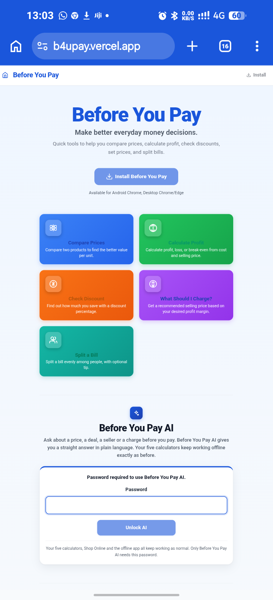
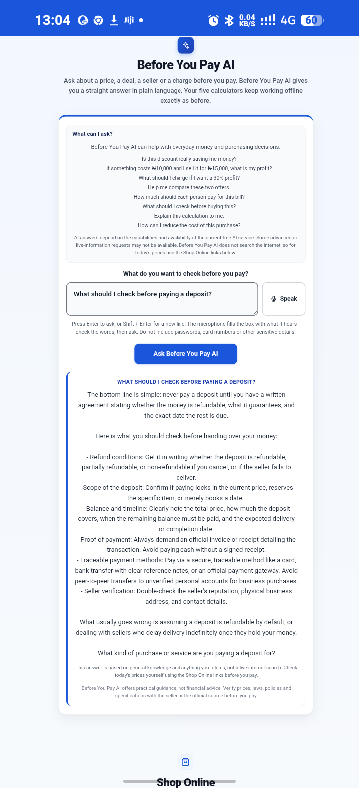
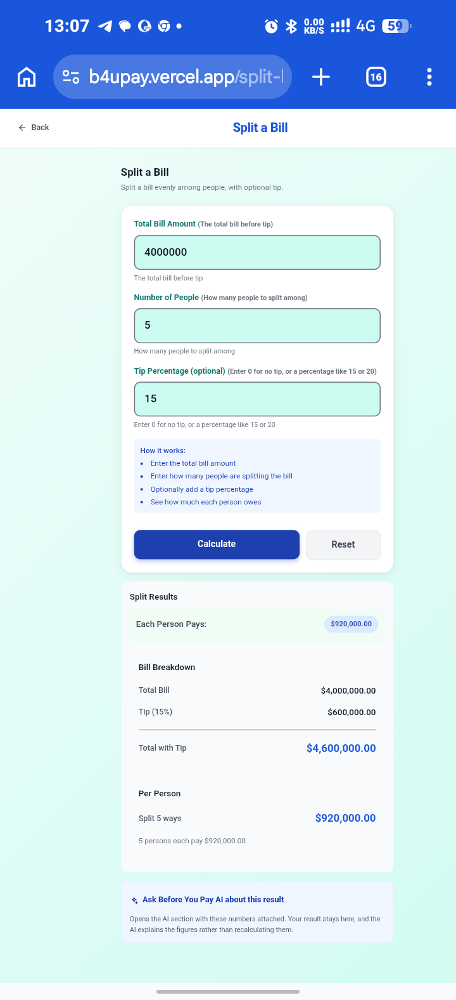

# Before You Pay: Money Decisions App

An installable, offline-capable app that helps people make better spending decisions before they pay. It has five calculators and an AI assistant with voice input.

**Live app:** https://b4upay.vercel.app

**Status:** Live

## What it does

- Five money calculators: price comparison, profit, discounts, pricing and bill splitting.

- An AI assistant that answers everyday price, deal and purchase questions in plain language.

- Voice input, so you can speak your question instead of typing.

- Works offline and installs on a phone or computer like a native app.

## Tech stack

React, Next.js, TypeScript, Node.js, Tailwind CSS, Progressive Web App (PWA) technologies, AI assistant integration, deployed on Vercel.

## Screenshots

## Source code

The source code is private. I am happy to walk through it in an interview or share access on request.

## Author

Oludamola Micheal Famoriyo, Osogbo, Nigeria

Email: famoriyooludamola@gmail.com

LinkedIn: https://www.linkedin.com/in/oludamola-famoriyo-ab951a416
